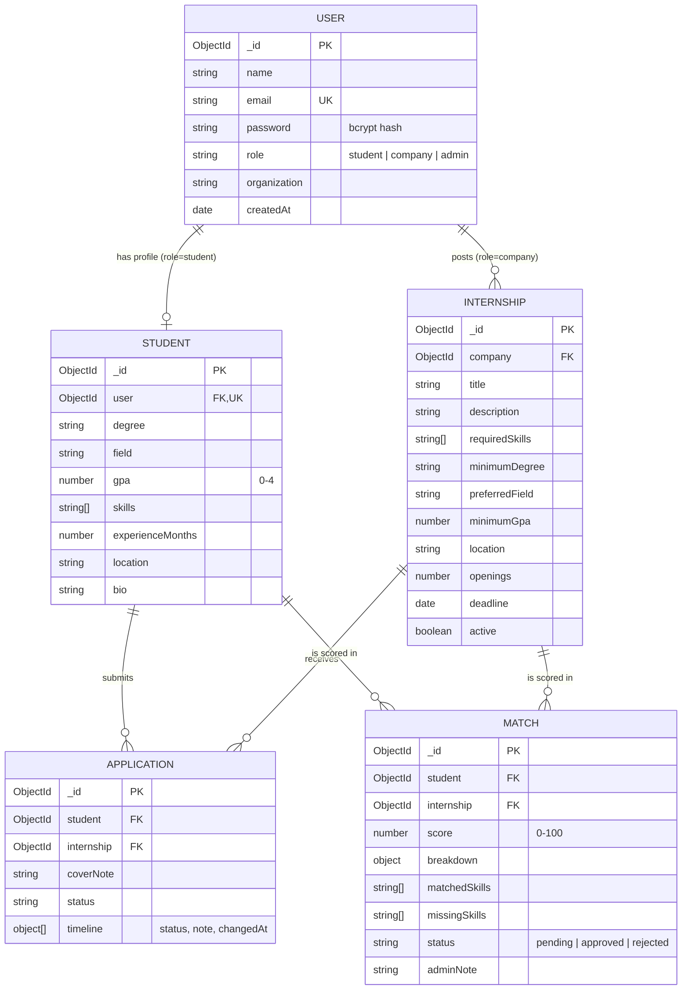

# SkillMatch: Smart Job Matching and Application Tracking System

A MERN web application. Companies publish job listings, candidates build qualification profiles and apply, and an admin generates explainable match scores and approves final results.

**Main entity with full CRUD: Job listing (`Internship` collection)**, stored persistently in MongoDB.

## CRUD summary

| Operation | Where in the UI | API |
|---|---|---|
| **Create** | Company dashboard > "New job" form (validated client + server) | `POST /api/internships` |
| **Read** | Job list with search, filters (location, degree, status), sort (6 options) and pagination; "Details" view for one record | `GET /api/internships`, `GET /api/internships/:id` |
| **Update** | Company dashboard > "Edit" on a listing (also open/close a listing) | `PUT /api/internships/:id` |
| **Delete** | Company dashboard > "Delete" with confirmation dialog; related matches and applications are removed too | `DELETE /api/internships/:id` |

Secondary entities also have CRUD: candidate profile (create/update), applications (create, update stage, withdraw, delete), matches (generate, review, update status).

## Features

- Roles: candidate, company, admin (JWT auth, bcrypt-hashed passwords, role-based route protection)
- Ownership checks: a company can only edit or delete its own listings
- Weighted match algorithm (skills 60, field 15, degree 10, GPA 10, location 5) with per-component breakdown
- Application timeline and stage tracking
- Validation on both client (inline field errors) and server (400 responses with per-field messages), plus a global error handler, so bad input never crashes the API
- Public home page that explains what the application does (how it works, user roles, match scoring) before sign in
- Responsive layout (desktop, tablet, phone)

## Tech stack

React 19 + Vite, Node.js + Express 5, MongoDB + Mongoose, JWT, bcryptjs.

## Setup

Requirements: Node.js 18+ and MongoDB running locally (or a MongoDB Atlas URI).

```bash
cp server/.env.example server/.env      # edit JWT_SECRET (and MONGO_URI if needed)
cp client/.env.example client/.env      # optional, API URL
npm install                             # installs the root dev tool (concurrently)
npm run install:all                     # installs server + client dependencies
npm run seed                            # loads demo users and jobs
npm run dev                             # API on :5000, web app on :5173
```

Open http://localhost:5173.
> **Windows note:** if port 5173 is blocked (error `EACCES`), start the client on another port, for example
> `npm run dev --prefix client -- --port 3000`, and set `CLIENT_URL=http://localhost:3000` in `server/.env`.

Demo accounts (password `Password123!`):

| Role | Email |
|---|---|
| Admin | admin@skillmatch.test |
| Candidate | student@skillmatch.test |
| Company | company@skillmatch.test (also company2@skillmatch.test) |

These accounts are created by `npm run seed`; they are not shown on the login page.

## Database design (ERD)



Design notes:
- One `User` collection with a `role`; a candidate's qualifications live in `Student` (1:1 via unique `user`), keeping login data separate from profile data.
- `Internship.company` references `User` (1:many). Indexed for fast "my listings" queries; a text index supports search.
- `Application` and `Match` are join collections between `Student` and `Internship` with a **unique compound index** on (student, internship), so duplicates are impossible at database level.
- Enums, min/max, length and regex constraints are enforced by Mongoose schemas.
- Deleting a listing cascades to its matches and applications.

The diagram source is in `docs/erd.mmd` (renders on GitHub, or at mermaid.live).

## API

Auth: `POST /api/auth/register`, `POST /api/auth/login`, `GET /api/auth/me`

Jobs: `GET /api/internships?search=&location=&degree=&status=&sort=&page=&limit=`, `GET|PUT|DELETE /api/internships/:id`, `POST /api/internships`

Candidate: `GET|PUT /api/students/profile`

Applications: `POST|GET /api/applications`, `PATCH /api/applications/:id/status`, `PATCH /api/applications/:id/withdraw`, `DELETE /api/applications/:id`

Matches (admin): `POST /api/matches/generate`, `GET /api/matches`, `PATCH /api/matches/:id/status`

Admin stats: `GET /api/dashboard/stats`

## Project structure

```
server/src
  index.js            app setup, route mounting
  models.js           Mongoose schemas
  validators.js       server-side validation rules
  middleware.js       auth, roles, id check, error handlers
  matcher.js          scoring algorithm
  routes/             auth, students, internships, matches, applications, dashboard
  seed.js             demo data
client/src
  api.js              fetch wrapper with error handling
  components/ui.jsx   shared UI (Field, Modal, Confirm, Toast, Tags)
  pages/              Auth, Student, Company, Admin, JobBrowser, JobDetail, JobForm, Profile
```

## Suggested demo order

1. Company: create a job (show a validation error first), search/filter/sort the list, edit it, delete it.
2. Candidate: complete profile, view job details, apply, withdraw, delete an application.
3. Admin: generate matches, approve/reject.
