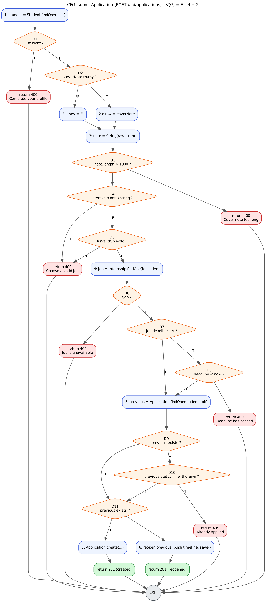

# Phase 4 – White-Box Testing

## 4.1 Function under analysis

The core business function is the **submit-application handler** (`POST /api/applications` in `server/src/routes/applications.js`). It combines the profile check, input validation, job availability, the deadline rule, duplicate handling and re-application. It is the function with the most decisions in the API layer.

## 4.2 Cyclomatic complexity

**Method 1 – decision count (V(G) = P + 1).** The handler has 11 atomic decisions (each operand of a logical OR / AND counts):

| # | Decision in code | Kind |
|---|---|---|
| D1 | `if (!student)` | if |
| D2 | `req.body.coverNote` OR `""` (default when missing) | logical OR |
| D3 | `if (note.length > 1000)` | if |
| D4 | `typeof req.body.internship !== "string"` | if, 1st operand of OR |
| D5 | `!mongoose.isValidObjectId(...)` | 2nd operand of OR |
| D6 | `if (!job)` | if |
| D7 | `job.deadline` | if, 1st operand of `&&` |
| D8 | `job.deadline < new Date()` | 2nd operand of `&&` |
| D9 | `previous` | if, 1st operand of `&&` |
| D10 | `previous.status !== "withdrawn"` | 2nd operand of `&&` |
| D11 | `if (previous)` | if |

V(G) = 11 + 1 = **12**

**Method 2 – graph formula (V(G) = E − N + 2).** The CFG below has N = 28 nodes and E = 38 edges, so V(G) = 38 − 28 + 2 = **12**. The counts were computed by a script from `docs/white-box/cfg-submit-application.dot`.

**Method 3 – tool.** ESLint's `complexity` rule reports the handler as **12**, which agrees.

Before the defect fixes the handler had only D1, D2, D3, D6, D7 and D8, so **V(G) = 7**. The NoSQL-injection fix (D4, D5) and the re-apply fix (D9–D11) raised it to 12. That is above the common threshold of 10, so §9 recommends extracting the duplicate/re-apply logic into a service function.

Complexity of every function above 5 (ESLint, final code; 58 functions in `server/src`, average 3.43):

| Function | File | V(G) |
|---|---|---|
| `validateInternship` | validators.js | 21 |
| `validateRegistration` | validators.js | 13 |
| list handler `GET /api/internships` | routes/internships.js | 12 |
| submit handler `POST /api/applications` | routes/applications.js | 12 |
| `validateProfile` | validators.js | 10 |
| login handler | routes/auth.js | 7 |
| withdraw handler | routes/applications.js | 7 |
| `errorHandler` | middleware.js | 7 |
| `DELETE /api/internships/:id` handler | routes/internships.js | 6 |

The validators have high V(G) but are flat sequences of independent `if`s, so they are easy to test (one test per rule). SonarQube's *cognitive* complexity penalises nesting rather than flat sequences, so it is expected to rate these validators lower than their cyclomatic complexity suggests; compare the two once the SonarQube scan has run.

## 4.3 Control Flow Graph

Source: `docs/white-box/cfg-submit-application.dot`. Rendered with Graphviz (`dot -Tpng`). Diamonds are decisions; red boxes are early returns; green boxes are success exits.

## 4.4 Basis paths (McCabe baseline method)

The baseline path B is the shortest success path. Each further path flips one decision.

| Path | Decisions | Outcome | Test |
|---|---|---|---|
| B | D1F D2F D3F D4F D5F D6F D7F D9F D11F | 201 created | DT-APP-R5b |
| P1 | flip D1 | 400 profile required | DT-APP-R1 |
| P2 | flip D2 (note supplied) | 201 created | BVA-NOTE length 999 |
| P3 | D2T + flip D3 | 400 note too long | DT-APP-R2 |
| P4 | flip D4 (object id) | 400 invalid job | SEC-A03-04 |
| P5 | flip D5 (string, not an ObjectId) | 400 invalid job | DT-APP-R8 |
| P6 | flip D6 | 404 job unavailable | DT-APP-R3 |
| P7 | flip D7 (deadline in future) | 201 created | BVA-DL-02 |
| P8 | D7T + flip D8 | 400 deadline passed | DT-APP-R4 |
| P9 | flip D9 (open previous application) | 409 already applied | API-RAP-02 |
| P10 | D9T + flip D10 | 201 reopened (D11T) | API-RAP-01 |
| P11 | flip D11 alone (D9F, D11T) | **infeasible** | – |

Eleven feasible independent paths are tested. The twelfth basis path is **infeasible**: D11 tests the same variable as D9, so "no previous application" and "previous application exists" cannot both hold. An infeasible basis path is a classic white-box signal of a redundant condition. Rewriting the block as nested `if (previous) { if (status !== "withdrawn") … else … }` removes it (recommendation R3 in §9).

## 4.5 Statement coverage vs branch coverage

| Goal | Minimum test set for this handler | Why |
|---|---|---|
| **Statement coverage** (every statement runs at least once) | DT-APP-R1, R2, R8, R3, R4, API-RAP-02, API-RAP-01, DT-APP-R5b (**8 tests**) | One test per exit statement; the reopen and create blocks each need their own test. |
| **Branch coverage** (every decision is both true and false) | The 8 above **+ SEC-A03-04** (D4 true) **+ BVA-DL-02** (D8 false) (**10 tests**) | Statement coverage alone never makes D4 true (R8 reaches the same `return` through D5) and never makes D8 false. |

This shows concretely why 100 % statement coverage can still hide untested branches. The NoSQL-injection branch (D4) is exactly the one that statement coverage would miss.

## 4.6 Coverage results (whole server, measured)

Measured with Node's built-in V8 coverage (`npm run test:coverage`), excluding only the `index.js` bootstrap:

| File | Lines % | Branches % | Functions % |
|---|---|---|---|
| app.js | 100 | 100 | 100 |
| middleware.js | 100 | 100 | 100 |
| models.js | 100 | 100 | 100 |
| routes/applications.js | 100 | 100 | 100 |
| routes/auth.js | 100 | 100 | 100 |
| routes/internships.js | 100 | 100 | 100 |
| routes/students.js | 100 | 100 | 100 |
| rules.js | 100 | 100 | 100 |
| validators.js | 100 | 100 | 100 |
| **All files** | **100** | **100** | **100** |

Progression:

| Run | Tests | Lines | Branches |
|---|---|---|---|
| Baseline, original code (`evidence/01-baseline-test-run-before-fixes.txt`) | 177 (7 failing = defects) | 100 % | 98.35 % |
| After fixes, before gap-filling tests | 209 | 100 % | 98.67 % |
| Final (`evidence/03-final-test-run-with-coverage.txt`) | 213 | 100 % | 100 % |

The three remaining uncovered branches were found in `coverage/lcov.info` (BRDA lines with 0 hits). Each got a targeted test: UT-PRF-05 (missing field of study), API-PRF-05 (location defaults to "Remote"), and UT-APP-01 (default CORS origin when `CLIENT_URL` is unset).

**Caveat (honest reading of 100 %):** coverage shows which code ran, not that it is correct. 100 % coverage did not reveal BUG-01 and BUG-02, which live in the client, nor BUG-06 (performance). Those were found by UI testing, load testing and static analysis.

## 4.7 Other white-box unit tests

| Unit | Branches covered | Tests |
|---|---|---|
| `auth` middleware | no header; malformed, wrong-secret and expired token; deleted user; success (and `select("-password")`) | WB-AUTH-01 … 06 |
| `allow`, `validId`, `wrap` | allowed or denied role; valid or invalid id; rejected promise forwarded | WB-ALW-*, WB-VID-*, WB-WRP-01 |
| `errorHandler` | ValidationError, CastError, duplicate key 11000, unknown error (no details leaked), malformed JSON, payload too large | WB-ERR-01 … 05, API-REG-05/06 |
| `createLoginLimiter` | under the limit; blocked with Retry-After; window expiry; reset on success; per-IP and per-email keys; missing body | WB-LIM-01 … 05 (injected clock) |
